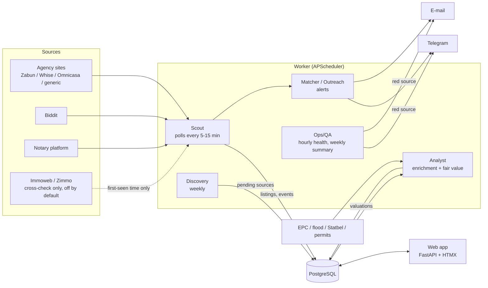

# Immo Agent

Immo Agent watches the Flemish housing market for you. It checks estate-agency websites, Biddit and the
notary platform every few minutes, tells you **within minutes** when a home that fits your search appears,
estimates a **fair price**, and **measures** how much of a head start you really get.

It runs on your own laptop (or later on a small rented server). You do not need to be a programmer:
this guide walks you through every step. Plan about **30 minutes** for the first start.

---

## Contents

1. [What you need](#1-what-you-need)
2. [First start, step by step](#2-first-start-step-by-step)
3. [Get alerts on your phone (Telegram) and by e-mail](#3-get-alerts-on-your-phone-telegram-and-by-e-mail)
4. [Fill the app with real listings](#4-fill-the-app-with-real-listings)
5. [Daily use](#5-daily-use)
6. [Handy commands](#6-handy-commands)
7. [When something goes wrong](#7-when-something-goes-wrong)
8. [Moving to a server with HTTPS](#8-moving-to-a-server-with-https)
9. [How it works (architecture)](#9-how-it-works-architecture)
10. [How each metric is calculated](#10-how-each-metric-is-calculated)
11. [Adding a source or a province](#11-adding-a-source-or-a-province)
12. [Compliance notes](#12-compliance-notes)
13. [For developers](#13-for-developers)

---

## 1. What you need

| What | Why | Where to get it |
|---|---|---|
| A laptop with Windows 10/11, macOS or Linux, 8 GB memory | runs everything | – |
| **Docker Desktop** | runs the app, the database and the background agents in one go | <https://www.docker.com/products/docker-desktop/> (free for personal use and small companies) |
| A **Telegram** account (optional, recommended) | the fastest alerts, on your phone | the Telegram app |
| An **e-mail sending service** (optional) | e-mail alerts | e.g. Brevo, Mailgun, Postmark, or your own mail host's SMTP details |

You do **not** need Python or any programming tools for normal use.

---

## 2. First start, step by step

### Step 1: Install Docker Desktop

1. Download Docker Desktop from the link above and install it like any other program.
2. Start Docker Desktop. Wait until it says **"Engine running"** (bottom left).
   Leave it running whenever you want Immo Agent to work.

### Step 2: Get the Immo Agent files

Pick one:

- **Easiest:** on the GitHub page of this project, click the green **Code** button → **Download ZIP**.
  Unzip it somewhere easy, for example `Documents/immo`.
- **With git:** `git clone https://github.com/janbaldi/immo.git`

### Step 3: Open a terminal in that folder

- **Windows:** open the `immo` folder in File Explorer, click in the address bar, type `powershell` and press Enter.
- **Mac:** open the **Terminal** app, type `cd ` (with a space), drag the `immo` folder into the window, press Enter.

Every command in this guide is typed in this window, followed by Enter.

### Step 4: Create your settings file

Copy the example settings file to a file called `.env`:

- **Windows (PowerShell):** `copy .env.example .env`
- **Mac / Linux:** `cp .env.example .env`

Open `.env` in a text editor (Notepad on Windows: `notepad .env`; Mac: `open -e .env`).
For now change only one line: replace `change-me-to-a-long-random-string` after `SECRET_KEY=`
with any long random text (for example 40 random letters and digits). Save the file.

> Files starting with a dot may be hidden. On Mac press `Cmd+Shift+.` in Finder to show them.
> Your `.env` contains passwords: never share it or upload it anywhere.

### Step 5: Start Immo Agent

```
docker compose up -d --build
```

The first time this downloads and builds everything (5–10 minutes). When it finishes, open
**<http://localhost:8000>** in your browser.

> `-d` means "keep running in the background". The app keeps working after you close the terminal,
> as long as Docker Desktop is running.

### Step 6: Create your account and make yourself admin

1. In the browser, click **Create an account**, fill in your e-mail and a password (8+ characters).
2. Back in the terminal, give your account the admin rights (replace the e-mail with yours):

   ```
   docker compose exec web immo admin create you@example.com
   ```

3. Refresh the browser. You now see extra admin links in the menu (Sources, Metrics, Model, …).

### Step 7: Create your first search

Click **Searches**, choose municipalities (hold Ctrl on Windows or Cmd on Mac to pick several),
type, price range, bedrooms, worst EPC label you accept, etc., and click **Save search**.
New homes that match appear in **Feed** and are sent to you as alerts.

---

## 3. Get alerts on your phone (Telegram) and by e-mail

### Telegram (recommended, fastest)

1. In Telegram, search for **@BotFather**, start a chat and send `/newbot`.
2. Choose a name (e.g. "My Immo Agent") and a username ending in `bot` (e.g. `myimmo_agent_bot`).
3. BotFather replies with a **token** (a long code like `123456:ABC-...`).
4. Open `.env` and fill in:
   ```
   TELEGRAM_BOT_TOKEN=the-token-from-botfather
   TELEGRAM_BOT_NAME=myimmo_agent_bot
   ```
5. Apply the change: `docker compose up -d`
6. In the app go to **Alerts** → **Connect Telegram** → click the link → press **Start** in Telegram.
   Within a minute the Alerts page shows **Connected** (refresh the page).

### E-mail

Fill in the details from your e-mail sending service in `.env`:

```
SMTP_HOST=smtp.your-provider.com
SMTP_PORT=587
SMTP_USER=your-login
SMTP_PASSWORD=your-password
SMTP_FROM=alerts@your-domain.be
ADMIN_EMAIL=you@example.com        # receives health warnings and the weekly summary
```

Then run `docker compose up -d`. You can switch e-mail alerts and quiet hours (for example 22 → 7)
on the **Alerts** page. Alerts that arrive during quiet hours are sent when the quiet hours end.

---

## 4. Fill the app with real listings

Immo Agent only shows **real** listings. Nothing is invented. Out of the box it knows Biddit and the
notary platform; estate-agency websites are found by the **discovery** agent and then approved by you.

1. **Find agency websites** in the province (takes a while; it is polite and waits 5 seconds between requests to the same site):
   ```
   docker compose exec web immo discover
   ```
   The worker also does this automatically every Sunday night.
2. In the app, open **Sources** → **pending**. For each agency, click **view** to check it is a real
   estate agency in the area, then **approve** (or **reject**). Approved sources start being checked right away.
   You can also add agencies by hand in `config/sources.yaml` (see [section 11](#11-adding-a-source-or-a-province)).
3. On its first visit to a source, the agent reads that site's whole current offer (the **backfill**). This fills
   your feed, the price history and the price model. Backfilled homes do **not** trigger alerts. Only homes
   that appear later do.
4. **Check that everything works** (runs every source once and sends a test alert to you):
   ```
   docker compose exec web immo check-live
   ```
   It prints, per source: listings found, how many pages were parsed, the success rate, missing key fields and
   whether `robots.txt` allows access. Then it tests Telegram and e-mail. The goal before inviting other users is
   **at least 100 working sources**.
5. Optional, improves the price model: import official municipality prices from Statbel:
   ```
   docker compose exec web immo statbel-import
   ```

The fair-price model trains itself every night once at least 100 real listings have been collected.
Until then (or for areas with fewer than 30 comparable homes) it shows **"insufficient data"** instead of guessing.

---

## 5. Daily use

- **Feed**: newest matching homes first, with badges (new, price drop, relisted, Biddit), the fair-price bar,
  EPC and flood chips, "first seen X min ago on source Y" and a link to the **original listing**.
- **Property page**: photos, price history, fair value with range, rent and yield (investors), comparable
  homes, "motivated seller" signals, and buttons to record what you did (save, contacted, visit booked, bid,
  bought at €…). These clicks feed your metrics.
- **My edge**: your personal numbers: how fast alerts reach you, how early you saw homes compared to the big
  portals, how fast you contacted the agency, and how prices compare to fair value. Each card has an ⓘ
  explanation and a **CSV** download.
- **Help**: FAQ and a question form. Questions arrive under **Tickets** for the admin.

**Admin pages**

| Page | What it is for |
|---|---|
| Sources | every source with a green/amber/red health light, on/off switch, "run now", polling interval, error log |
| Metrics | the same metrics for all users together, with CSV export |
| Model | price-model quality (error and range coverage) after each nightly retrain |
| Users | users, plan, and **segment caps** (maximum active clients per municipality and segment) |
| Tickets | user questions, and visit-request drafts waiting for approval |
| Dedup review | check whether listings merged into one home really are the same home (needed for the 14-day report) |
| Parser test | paste any listing URL and see what the parser reads from it |

**After 14 days of running**, produce the acceptance report:

```
docker compose exec web immo report --check-links
```

It prints a PASS/FAIL table and saves it in the `reports` folder.

---

## 6. Handy commands

Type these in the terminal, in the `immo` folder. (Mac/Linux users with `make` can use the short form.)

| I want to… | Command | Short form |
|---|---|---|
| start everything | `docker compose up -d --build` | `make up` |
| stop everything (data is kept) | `docker compose down` | `make down` |
| see what the agents are doing | `docker compose logs -f web worker` | `make logs` |
| apply changes to `.env` | `docker compose up -d` | |
| make someone admin | `docker compose exec web immo admin create EMAIL` | `make admin EMAIL=...` |
| find agency websites | `docker compose exec web immo discover` | `make discover` |
| check all sources once now | `docker compose exec web immo run` | `make run` |
| health check against live sources | `docker compose exec web immo check-live` | `make check-live` |
| 14-day acceptance report | `docker compose exec web immo report --check-links` | `make report` |
| retrain the price model now | `docker compose exec web immo train` | `make train` |
| see what the parser reads from a URL | `docker compose exec web immo parse URL` | |
| list all commands | `docker compose exec web immo --help` | |

Your data lives in Docker volumes and survives restarts and updates. To update to a newer version:
download the new files (or `git pull`), then `docker compose up -d --build`.

---

## 7. When something goes wrong

| Symptom | What to do |
|---|---|
| `docker: command not found` / "cannot connect to the Docker daemon" | start Docker Desktop and wait for "Engine running" |
| <http://localhost:8000> does not open | wait a minute after starting; then check `docker compose ps` (all should be "Up") and `docker compose logs web` |
| port 8000 is already in use | another program uses it; stop that program, or change `"8000:8000"` to `"8080:8000"` in `docker-compose.yml` and open <http://localhost:8080> |
| a source shows **red** | open it under Sources to see the reason. "robots.txt disallows" = the site does not allow automated access, so switch it off. "no listings any more" = the site changed its layout; try **Parser test** with one of its listing URLs, and see section 11 |
| no Telegram alerts | check `TELEGRAM_BOT_TOKEN` and `TELEGRAM_BOT_NAME`, run `docker compose up -d`, reconnect under **Alerts**, then `immo check-live` |
| no e-mail alerts | check the `SMTP_*` lines; many providers need you to verify the sender address first |
| "insufficient data" everywhere | normal for the first days: the model needs ≥100 real listings, and ≥30 comparable homes per area |
| I want to start over completely | `docker compose down -v` (**deletes all data**), then `docker compose up -d --build` |

---

## 8. Moving to a server with HTTPS

Any small Linux server (VPS, 2 GB memory) with Docker works.

1. Point a domain name (e.g. `immo.your-domain.be`) to the server's IP address (an "A record" at your domain provider).
2. Copy the project folder and your `.env` to the server.
3. In `.env` set `DOMAIN=immo.your-domain.be` and `BASE_URL=https://immo.your-domain.be`.
4. Start with the extra HTTPS proxy (Caddy gets a free certificate automatically):
   ```
   docker compose --profile vps up -d --build
   ```
5. Open `https://immo.your-domain.be`. On a server, you may remove the `ports: "8000:8000"` lines
   so the app is reachable only through HTTPS.

---

## 9. How it works (architecture)



- **Scout** reads each source's newest-listings page and opens a detail page only when a listing is new or its
  card changed. It strips personal data, then stores the listing. The same home on several sites becomes **one
  property** with several listings: matched on the normalised address, or else on municipality + type + living
  area (±3 m²) + price (±2%), confirmed by comparing the first photos (perceptual hash).
  Every price, status or description change is recorded as an event (new, price drop/increase, status change,
  relisted, removed).
- **Analyst** adds EPC, flood scores, Statbel prices and permit counts where available, and computes fair value
  with an 80% range, rent and gross yield (from collected rental listings), and a motivated-seller score.
- **Matcher** checks every new event against all searches and sends alerts immediately (respecting quiet hours).
  With outreach switched on, it also drafts a visit request.
- **Ops/QA** checks every source every hour and warns the founder when one turns red.
- Politeness: `robots.txt` is respected and cached, the user agent says who we are, and there is at most one request
  per site every 5 seconds.

Code layout:

```
immo_agent/
  core/         config, database, data model, personal-data guard, optional LLM
  sources/      polite fetcher, generic extractor, agency (Zabun/Whise/Omnicasa/generic), Biddit & notary (JSON), portals
  enrichment/   EPC, flood, Statbel, permits adapters
  analysis/     dedup, change detection, valuation (+ rent, yield, signals)
  agents/       scout, analyst, matcher, outreach, ops_qa
  metrics.py    the seven metrics + CSV export
  discovery.py  agency finder + template detection
  notify.py     Telegram + e-mail
  web/          FastAPI app + Jinja2/HTMX/Tailwind templates
  worker.py     schedule of all agents
  report.py     14-day acceptance report
  cli.py        the `immo` command
config/         sources.yaml, provinces.yaml, discovery.yaml
tests/
```

---

## 10. How each metric is calculated

All metrics exist per user, per search and for everyone (admin), with a CSV export. Times are in minutes.

| Metric | Formula | Notes |
|---|---|---|
| **Time to alert** | `alert.sent_at − property.first_seen_anywhere_at` | alerts about new homes sent by Telegram/e-mail. Target: median < 15 min |
| **Lead time vs portals** | `portal_first_seen_at − first_seen_anywhere_at` | positive = we saw it first. Shows median and % seen before the portal. Shows "not measured" until the portal cross-check is switched on |
| **Detection latency** | `first_seen_anywhere_at − published_at` | only where a source publishes a publication time; backfilled listings excluded. Shows how fresh polling really is, per source |
| **Time to first contact** | earliest of (visit request sent, "I contacted the agency" click) `− alert.sent_at` | |
| **Price vs fair value** | `(asking or paid price − fair value) / fair value` | negative = below fair value; paid price from the "Bought at €…" button |
| **Coverage** | new listings per source per day; share of all properties each source found first | |
| **Model quality** | MAPE and 80%-range coverage on 20% held-out real listings at each nightly retrain | plus range coverage on homes that later dropped in price or sold (Model page, report) |

---

## 11. Adding a source or a province

**An agency by hand:** add it to `config/sources.yaml`:

```yaml
  - name: Voorbeeld Vastgoed
    kind: zabun            # zabun | whise | omnicasa | generic
    base_url: https://www.voorbeeldvastgoed.be
    list_url: https://www.voorbeeldvastgoed.be/nl/te-koop
    poll_minutes: 10
```

Then `docker compose restart web worker`. Not sure of the template? Use `generic`, or run discovery, which detects it.
Use **Parser test** with one of its listing URLs to see what is read.

**A site that needs JavaScript:** add `use_browser: true` to the source and set `ENABLE_PLAYWRIGHT=true`
(needs the browser extra; see section 13).

**A new province:** add it to `config/provinces.yaml` (postal-code ranges and, optionally, municipality names), set
`PROVINCE=` in `.env`, set `province:` in `config/discovery.yaml`, run `immo discover` and approve the results.
No code changes needed.

**Switching a source off:** the on/off button under Sources (kill switch), or `enabled: false` in `sources.yaml`.

---

## 12. Compliance notes

- **Primary sources only by default**: agency websites, Biddit, notary platform. The big portals (Immoweb, Zimmo,
  …) are **off** and, when switched on after legal review (`PORTAL_CROSSCHECK_ENABLED=true` plus the source switch),
  are only used to note *when* a property we already know appears there. Their content is never stored or shown.
- **robots.txt** is checked (and cached for 24 h) before every request; a site that disallows us is skipped and shown red.
- **Rate limit**: at most one request per site every 5 seconds; clear `User-Agent` header.
- **No personal data**: only property facts are stored. Contact names, phone numbers and e-mail addresses are removed
  when a page is read (tested), and `immo report` scans the database for them. Photos are links to the original
  site, not copies.
- **Every alert and listing links to the original source.**
- **Outreach** (off by default): the agency's e-mail address is read from the live page at sending time and not
  stored; messages are saved without personal data; "approve" mode needs one click per message.

---

## 13. For developers

```
make dev-install            # uv venv + editable install with dev tools
make test                   # pytest with coverage (SQLite)
make lint typecheck         # ruff + mypy
make dev-web                # run without Docker (SQLite file immo.db)
make dev-worker
make check-live IMMO=.venv/bin/immo
```

- Python 3.12+, FastAPI, SQLAlchemy 2 + Alembic, PostgreSQL (SQLite for tests), APScheduler, httpx, selectolax,
  scikit-learn (quantile gradient boosting), Jinja2 + HTMX + Tailwind CDN.
- New migration after changing `core/models.py`: `.venv/bin/alembic revision --autogenerate -m "what changed"`.
- **Recorded fixtures:** `immo record-fixture <listing-url> <name>` saves a real page in
  `tests/fixtures/recorded/`; `tests/test_recorded.py` then checks every recorded page automatically.
- Optional extras: `.[llm]` (Anthropic; set `LLM_PROVIDER=anthropic` and `ANTHROPIC_API_KEY`) fills fields the
  rules could not find and polishes visit requests; `.[browser]` + `playwright install chromium` for JavaScript sites.

Assumptions, open points and everything that still needs checking against the live sites: **[DECISIONS.md](DECISIONS.md)**.
